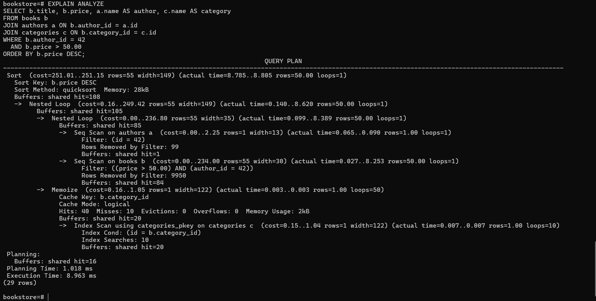

# PostgreSQL

#### 1. Create a New Database (Optional)

If you want a dedicated database instead of using the default `postgres` database:


```plsql
CREATE DATABASE bookstore;
\c bookstore
```


#### 2. Schema Definition (PostgreSQL Syntax)

Key conversions from MySQL to PostgreSQL:

* `AUTO_INCREMENT` $$ $\rightarrow$ $$ `SERIAL` (or `GENERATED ALWAYS AS IDENTITY`)
*   `DROP TABLE ... CASCADE` to cleanly remove dependent foreign keys<br>

    <pre class="language-plsql" data-title="" data-overflow="wrap" data-line-numbers data-expandable="true"><code class="lang-plsql">DROP TABLE IF EXISTS books CASCADE;
    DROP TABLE IF EXISTS authors CASCADE;
    DROP TABLE IF EXISTS categories CASCADE;

    CREATE TABLE authors (
        id SERIAL PRIMARY KEY,
        name VARCHAR(100) NOT NULL,
        country VARCHAR(50) NOT NULL
    );

    CREATE TABLE categories (
        id SERIAL PRIMARY KEY,
        name VARCHAR(50) NOT NULL
    );

    CREATE TABLE books (
        id SERIAL PRIMARY KEY,
        title VARCHAR(255) NOT NULL,
        price NUMERIC(6,2) NOT NULL,
        author_id INT REFERENCES authors(id) ON DELETE SET NULL,
        category_id INT REFERENCES categories(id) ON DELETE SET NULL,
        published_year INT
    );
    </code></pre>

#### 3. Seed Data Script

Run this block directly in `psql`:


```plsql
-- 1. Seed Categories (10 records)
INSERT INTO categories (name) VALUES 
('Programming'), ('Science Fiction'), ('Databases'), ('DevOps'), 
('Design'), ('History'), ('Philosophy'), ('Business'), ('Networking'), ('Security');

-- 2. Seed 100 Authors
-- Uses generate_series and array subscripting to simulate ELT(RAND())
INSERT INTO authors (name, country)
SELECT 
    'Author_' || i,
    (ARRAY['USA', 'India', 'UK', 'Germany'])[floor(random() * 4 + 1)::int]
FROM generate_series(1, 100) AS i;

-- 3. Seed 10,000 Books
-- Fast bulk set-generation
INSERT INTO books (title, price, author_id, category_id, published_year)
SELECT 
    'Book Title #' || i,
    round((10 + (random() * 90))::numeric, 2),
    floor(random() * 100 + 1)::int,   -- Random author_id from 1 to 100
    floor(random() * 10 + 1)::int,    -- Random category_id from 1 to 10
    floor(2000 + (random() * 26))::int -- Random year between 2000 and 2025
FROM generate_series(1, 10000) AS i;
```


<figure><figcaption></figcaption></figure>

#### 4. Verification Queries:


```plsql
SELECT count(*) FROM categories;  -- Output: 10
SELECT count(*) FROM authors;     -- Output: 100
SELECT count(*) FROM books;       -- Output: 10000

-- Sample check
SELECT 
    b.id, 
    b.title, 
    b.price, 
    a.name AS author, 
    a.country, 
    c.name AS category, 
    b.published_year
FROM books b
JOIN authors a ON b.author_id = a.id
JOIN categories c ON b.category_id = c.id
LIMIT 5;
```


<figure><figcaption></figcaption></figure>

### Indexes:

#### Baseline Query Analysis (Without Indexes)

Foreign keys in PostgreSQL do not automatically create indexes on referencing columns. Running filter, sort, or join queries on `books` defaults to a Sequential Scan (scanning every row).

Run `EXPLAIN ANALYZE` on an unindexed query:

SQL

```plsql
EXPLAIN ANALYZE
SELECT b.title, b.price, a.name AS author, c.name AS category
FROM books b
JOIN authors a ON b.author_id = a.id
JOIN categories c ON b.category_id = c.id
WHERE b.author_id = 42 
  AND b.price > 50.00
ORDER BY b.price DESC;
```

Output:<br>

<figure><figcaption></figcaption></figure>

#### Creating Relevant Indexes


```plsql
-- 1. Index on Foreign Keys (Crucial for JOINs and WHERE clauses on relations)
CREATE INDEX idx_books_author_id ON books(author_id);
CREATE INDEX idx_books_category_id ON books(category_id);

-- 2. Composite Index (For multi-column filter + sort queries: author_id and price)
CREATE INDEX idx_books_author_price ON books(author_id, price DESC);

-- 3. Partial Index (Useful if querying a specific frequent subset, e.g., recent books)
CREATE INDEX idx_books_recent ON books(published_year) WHERE published_year >= 2020;
```


<figure><figcaption></figcaption></figure>

#### Evaluating Performance with EXPLAIN ANALYZE

Re-run the previous query to observe the index plan:


```plsql
EXPLAIN (ANALYZE, BUFFERS)
SELECT b.title, b.price, a.name AS author, c.name AS category
FROM books b
JOIN authors a ON b.author_id = a.id
JOIN categories c ON b.category_id = c.id
WHERE b.author_id = 42 
  AND b.price > 50.00
ORDER BY b.price DESC;
```


output:

<figure><figcaption></figcaption></figure>

**Key Metrics to Check in EXPLAIN ANALYZE:**

| **Metric**             | **Target / Good Indicator**                            | **Description**                                                                 |
| ---------------------- | ------------------------------------------------------ | ------------------------------------------------------------------------------- |
| Scan Type              | `Index Scan` / `Index Only Scan` / `Bitmap Index Scan` | Avoids costly `Seq Scan` (full table read).                                     |
| Actual Time            | Lower total runtime (`execution time: < 1ms`)          | Real elapsed execution time measured during the run.                            |
| Buffers                | High `shared hit`, zero/low `shared read`              | Data served from shared memory cache rather than disk/flash storage.            |
| Rows Removed by Filter | As close to `0` as possible                            | Indicates the index filtered rows directly instead of filtering them post-read. |

#### **Inspecting Index Sizes**


```plsql
SELECT
    indexname,
    pg_size_pretty(pg_relation_size(indexname::regclass)) AS index_size
FROM pg_indexes
WHERE tablename = 'books';
```


<figure><figcaption></figcaption></figure>

#### Terminal & Connection Commands

* `psql -U <username> -d <database>`: Connect to a specific database as a specific user.
* `psql -h <host> -p <port> -U <username> -d <database>`: Connect to a remote or custom-port database.
* `pg_ctl -D <data_dir> start|stop|restart|status`: Control the background server process from the she

**Essential `psql` Meta-Commands (Interactive Shell)**

Run these directly inside the `psql` prompt (prefixed with `\`):

| **Command**             | **Action**                                                                  |
| ----------------------- | --------------------------------------------------------------------------- |
| `\l` or `\l+`           | List all databases (with sizes and access permissions)                      |
| `\c <database>`         | Connect / switch to another database                                        |
| `\dt` or `\dt+`         | List all tables in current database                                         |
| `\d <table_name>`       | Describe table schema, columns, types, and constraints                      |
| `\d+ <table_name>`      | Describe table with extra details (indexes, foreign keys, storage)          |
| `\di`                   | List all indexes                                                            |
| `\df`                   | List all stored functions / procedures                                      |
| `\du`                   | List all users and their assigned roles                                     |
| `\dn`                   | List all schemas                                                            |
| `\x`                    | Toggle expanded table view (rotates columns to rows, great for wide tables) |
| `\timing`               | Toggle query execution time display                                         |
| `\i <path/to/file.sql>` | Execute a local `.sql` script file                                          |
| `\q`                    | Quit / exit `psql`                                                          |


```plsql
-- Database, User & Permission Management (SQL)
-- Create & Drop Databases
CREATE DATABASE dev_db;
DROP DATABASE IF EXISTS dev_db;

-- User Management
CREATE USER app_user WITH ENCRYPTED PASSWORD 'secret_password';
ALTER USER app_user WITH SUPERUSER;
DROP USER IF EXISTS app_user;

-- Grants & Permissions
GRANT ALL PRIVILEGES ON DATABASE dev_db TO app_user;
GRANT SELECT, INSERT, UPDATE, DELETE ON ALL TABLES IN SCHEMA public TO app_user;

-- Schema Inspection & Table Diagnostics (SQL)
-- Check active connections & running queries
SELECT pid, usename, client_addr, state, query, age(clock_timestamp(), query_start) 
FROM pg_stat_activity 
WHERE state != 'idle';

-- Terminate / kill a stuck query by PID
SELECT pg_terminate_backend(<pid>);

-- Check table and index disk usage
SELECT 
    relname AS object_name,
    pg_size_pretty(pg_total_relation_size(relid)) AS total_size,
    pg_size_pretty(pg_relation_size(relid)) AS table_size,
    pg_size_pretty(pg_indexes_size(relid)) AS index_size
FROM pg_catalog.pg_statio_user_tables
ORDER BY pg_total_relation_size(relid) DESC;
```



```bash
# Backup & Restore (Shell Commands)
# Export single database to plain SQL text
pg_dump -U <username> -d <database> > backup.sql

# Export in custom compressed format (faster, supports parallel restore)
pg_dump -U <username> -Fc <database> > backup.dump

# Restore from plain SQL file
psql -U <username> -d <target_db> < backup.sql

# Restore from compressed format
pg_restore -U <username> -d <target_db> -v backup.dump
```

