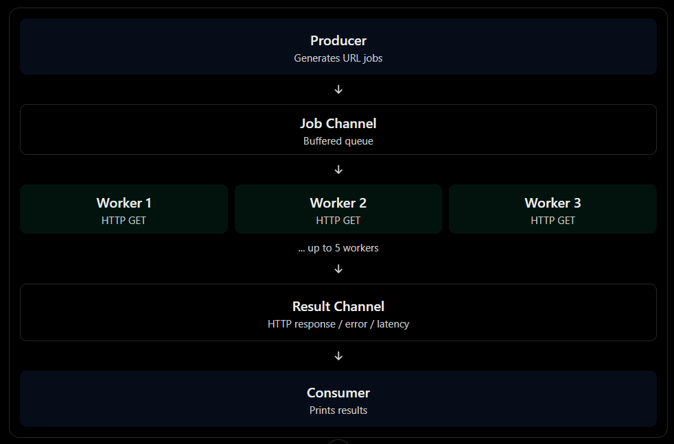

# url fetcher - 4
```go
package main

import (
	"context"
	"fmt"
	"io"
	"net/http"
	"os"
	"sync"
	"time"
)

const (
	workerPoolSize = 5
)

type Job struct {
	url string
}

type result struct {
	workerId   int
	url        string
	statusCode int
	body       []byte
	err        error
	latency    time.Duration
}

func get(parentCtx context.Context,
	sharedHttpClient *http.Client,
	id int,
	url string) result {

	childCtx, childCancel := context.WithTimeout(parentCtx, 2*time.Second)
	defer childCancel()

	start := time.Now()

	req, err := http.NewRequestWithContext(childCtx, http.MethodGet, url, nil)
	if err != nil {
		return result{workerId: id, url: url, err: err}
	}

	resp, err := sharedHttpClient.Do(req)
	if err != nil {
		return result{workerId: id, url: url, err: err}
	}

	defer resp.Body.Close() // Guaranteed to run after io.ReadAll finishes

	body, err := io.ReadAll(resp.Body)
	if err != nil {
		return result{workerId: id, url: url, err: err}
	}

	t := time.Since(start).Round(time.Millisecond)

	return result{
		workerId:   id,
		url:        url,
		statusCode: resp.StatusCode,
		body:       body,
		err:        err,
		latency:    t,
	}
}

func worker(parentCtx context.Context,
	id int,
	sharedHttpClient *http.Client,
	job <-chan Job, // ingress chan
	ch chan<- result, // egress chan
	wg *sync.WaitGroup) {
	defer wg.Done()

	for j := range job {
		ch <- get(parentCtx, sharedHttpClient, id, j.url)
	}
}

func main() {
	urls := []string{
		"https://google.com",
		"https://example.com",
		"https://httpbin.org/get",

		//Different HTTP status codes
		"https://httpbin.org/status/200",
		"https://httpbin.org/status/400",
		"https://httpbin.org/status/404",
		"https://httpbin.org/status/503",

		//Slow responses
		"https://httpbin.org/delay/5",

		//Redirect handling
		"https://httpbin.org/redirect/3",
		"https://httpbin.org/absolute-redirect/2",
		"https://httpbin.org/relative-redirect/2",

		//Large response bodies
		"https://httpbin.org/bytes/1048576",
		"https://httpbin.org/stream/100",
		"https://httpbin.org/stream/500",
	}

	job := make(chan Job, workerPoolSize)
	result := make(chan result, workerPoolSize)

	var wg sync.WaitGroup

	// Covers connection + headers + full body read for each individual request
	sharedHttpClient := &http.Client{
		//Timeout: 3 * time.Second, // timeout for each request
	}

	ctx, cancel := context.WithTimeout(context.Background(), 10*time.Second)
	defer cancel()

	// spawm the workers
	for i := 1; i <= workerPoolSize; i++ {
		wg.Add(1)
		go worker(ctx, i, sharedHttpClient, job, result, &wg)
	}

	// Producer: respects ctx.Done() so it never blocks if batch times out early
	go func() {
		defer close(job) // signal no more jobs comming
		for _, url := range urls {
			job <- Job{url: url}
		}
	}()

	go func() {
		wg.Wait()
		close(result)
	}()

	for r := range result {
		if r.err != nil {
			fmt.Fprintf(os.Stderr, "worker-[%d]: error in fetching url:[%s]; err:%s\n", r.workerId, r.url, r.err.Error())
		} else {
			fmt.Fprintf(os.Stdout, "worker-[%d]: successful; url:[%s]; statusCode:%d, latency:%v, body:%+v\n", r.workerId, r.url, r.statusCode, r.latency, len(r.body))
		}
	}
}
```

Output:
```
$ go run url-fetcher.go 
worker-[2]: successful; url:[https://example.com]; statusCode:200, latency:181ms, body:577
worker-[1]: successful; url:[https://google.com]; statusCode:200, latency:297ms, body:89529
worker-[4]: successful; url:[https://httpbin.org/status/200]; statusCode:200, latency:663ms, body:0
worker-[5]: successful; url:[https://httpbin.org/status/400]; statusCode:400, latency:663ms, body:0
worker-[1]: successful; url:[https://httpbin.org/status/503]; statusCode:503, latency:365ms, body:0
worker-[2]: successful; url:[https://httpbin.org/status/404]; statusCode:404, latency:482ms, body:0
worker-[3]: successful; url:[https://httpbin.org/get]; statusCode:200, latency:663ms, body:217
worker-[2]: successful; url:[https://httpbin.org/relative-redirect/2]; statusCode:200, latency:1.03s, body:275
worker-[1]: successful; url:[https://httpbin.org/absolute-redirect/2]; statusCode:200, latency:1.189s, body:275
worker-[5]: successful; url:[https://httpbin.org/redirect/3]; statusCode:200, latency:1.389s, body:275
worker-[3]: successful; url:[https://httpbin.org/bytes/1048576]; statusCode:200, latency:1.389s, body:1048576
worker-[1]: successful; url:[https://httpbin.org/stream/500]; statusCode:400, latency:201ms, body:107
worker-[2]: successful; url:[https://httpbin.org/stream/100]; statusCode:200, latency:361ms, body:17490
worker-[4]: error in fetching url:[https://httpbin.org/delay/5]; err:Get "https://httpbin.org/delay/5": context deadline exceeded
$
```

## Good Parts about the code:
### Worker Pool pattern
the above code is Worker Pool pattern
the code has separated the workload into:
- Producer: generates jobs.
- Workers: execute HTTP requests.
- Result consumer: processes completed requests.
This is a good separation of responsibilities.



### Reusing a shared HTTP client
An http.Client is safe for concurrent use by multiple goroutines.

Reusing the client allows Go's underlying http.Transport to reuse TCP connections and maintain connection pools.

Creating a new HTTP client for every request would be unnecessary and could reduce connection reuse.

### Context propagation
Parent context controls the overall batch.
Child context controls an individual request.
Cancellation propagates from parent to child.

### Proper response body closure
using a single dedicated fuction to fetch the url per request is must here as defer is function-scoped, not block-scoped. Every response body stays open in memory until the worker goroutine exits, leaking TCP connections and file descriptors across large URL lists.
so Extract the single-URL fetch into a dedicated helper function (fetchURL(...)) so defer childCancel() and defer resp.Body.Close() execute immediately after every request.

## Problems in the code:
### Critical: producer ignoring context cancellation
Imagine:
1. Your batch context expires after 10 seconds.
2. All workers are blocked or have exited.
3. The producer is still trying to send jobs.
4. The job channel becomes full.
5. Nobody receives from it.
6. The producer goroutine remains blocked.
the code has a potential goroutine leak.

Fix:
```go
go func() {
    defer close(job)

    for _, url := range urls {
        select {
        case job <- Job{url: url}:
        case <-ctx.Done(): // <------------------
            return
        }
    }
}()
```
Now the producer can exit when the parent context is cancelled.

### Critical: Your worker's result send is not cancellation-aware
Suppose the consumer stops receiving results.

The worker may block indefinitely while sending to the result channel.

Also, after the parent context expires, workers continue ranging over the job channel until it closes.

the worker should be cancellation-aware.
fix:
```go
func worker(
    ctx context.Context,
    id int,
    client *http.Client,
    jobs <-chan Job,
    results chan<- result,
    wg *sync.WaitGroup,
) {
    defer wg.Done()

    for {
        select {
        case <-ctx.Done():
            return

        case j, ok := <-jobs:
            if !ok {
                return
            }

            r := get(ctx, client, id, j.url)

            select {
            case results <- r:
            case <-ctx.Done():
                return
            }
        }
    }
}
```
Notice two things:
1. The worker can stop when the parent context is cancelled.
2. The worker doesn't get permanently stuck trying to publish a result.


### No response body size limit
This is potentially dangerous in production.

Imagine somebody provides a URL returning a 2 GB response.

Your application attempts to load the entire response into memory.

With five workers, this can result in substantial memory consumption.

Improvement:
```go
const maxResponseSize = 5 << 20 // 5 MB

body, err := io.ReadAll(
    io.LimitReader(resp.Body, maxResponseSize+1),
)

if err != nil {
    return result{
        workerId: id,
        url:      url,
        err:      err,
    }
}

if len(body) > maxResponseSize {
    return result{
        workerId: id,
        url:      url,
        err:      fmt.Errorf("response body exceeds %d bytes", maxResponseSize),
    }
}
```

### HTTP client configuration (Production)
```go
transport := &http.Transport{
    MaxIdleConns:        100, // Maximum total idle connections
    MaxIdleConnsPerHost: 10, // Maximum idle connections per host
    MaxConnsPerHost:     10, //Maximum total connections per host
    IdleConnTimeout:     90 * time.Second, // How long idle connections remain open
}

sharedHttpClient := &http.Client{
    Transport: transport,
    Timeout:   15 * time.Second, // Overall request timeout
}
```

### No graceful shutdown or external cancellation
```go
ctx, cancel := context.WithTimeout(context.Background(), 10*time.Second)
``` 
This is fine for a simple demonstration.

For a long-running service, you should support OS signals.

For example:
```go
ctx, stop := signal.NotifyContext(
    context.Background(),
    os.Interrupt,
    syscall.SIGTERM,
)
defer stop()
```

Now your service can react to:
- Ctrl+C.
- Kubernetes pod termination.
- Container shutdown.
- SIGTERM.

## Improved Code:
```go
package main

import (
	"context"
	"fmt"
	"io"
	"net/http"
	"os"
	"os/signal"
	"sync"
	"syscall"
	"time"
)

const (
	workerPoolSize = 5
)

type Job struct {
	url string
}

type result struct {
	workerId   int
	url        string
	statusCode int
	body       []byte
	err        error
	latency    time.Duration
}

func get(parentCtx context.Context,
	sharedHttpClient *http.Client,
	id int,
	url string) result {

	childCtx, childCancel := context.WithTimeout(parentCtx, 2*time.Second)
	defer childCancel()

	start := time.Now()

	req, err := http.NewRequestWithContext(childCtx, http.MethodGet, url, nil)
	if err != nil {
		return result{workerId: id, url: url, err: err}
	}

	resp, err := sharedHttpClient.Do(req)
	if err != nil {
		return result{workerId: id, url: url, err: err}
	}

	defer resp.Body.Close() // Guaranteed to run after io.ReadAll finishes

	const maxResponseSize = 5 << 20 // 5 MB

	//body, err := io.ReadAll(resp.Body)
	body, err := io.ReadAll(io.LimitReader(resp.Body, maxResponseSize+1))
	if err != nil {
		return result{workerId: id, url: url, err: err}
	}
	if len(body) > maxResponseSize {
		return result{workerId: id, url: url, err: fmt.Errorf("response body exceeds maximum size")}
	}

	t := time.Since(start).Round(time.Millisecond)

	return result{
		workerId:   id,
		url:        url,
		statusCode: resp.StatusCode,
		body:       body,
		err:        err,
		latency:    t,
	}
}

func worker(parentCtx context.Context,
	id int,
	sharedHttpClient *http.Client,
	job <-chan Job, // ingress chan
	result chan<- result, // egress chan
	wg *sync.WaitGroup) {
	defer wg.Done()

	for {
		// Avoid picking up additional jobs after cancellation.
		if parentCtx.Err() != nil { // This reduces unnecessary job processing after cancellation.
			return
		}
		select {
		case j, ok := <-job:
			if !ok { // means job is closed
				return
			}

			/*
				What happens when both cases are ready?

				Go randomly selects one of the ready cases.

				It does NOT prioritize parentCtx.Done().

				For example:
				1. Parent context expires.
				2. Job channel still contains pending jobs.
				3. Both select cases become ready.
				4. Go might select the job channel.
				5. Worker picks up another job even though cancellation has happened.
				the get() function will receive an already-cancelled context, so the HTTP request should terminate immediately.
				But workers are still unnecessarily picking up work.

				Improvement:
				Add a cancellation check before entering the select and after receiving a job.
			*/
			// Cancellation might have happened while receiving.
			if parentCtx.Err() != nil { // This reduces unnecessary job processing after cancellation.
				return
			}

			r := get(parentCtx, sharedHttpClient, id, j.url)
			select {
			case result <- r:
			case <-parentCtx.Done():
				return
			}

		case <-parentCtx.Done():
			return
		}
	}
}

func main() {
	urls := []string{
		"https://google.com",
		"https://example.com",
		"https://httpbin.org/get",

		//Different HTTP status codes
		"https://httpbin.org/status/200",
		"https://httpbin.org/status/400",
		"https://httpbin.org/status/404",
		"https://httpbin.org/status/503",

		//Slow responses
		"https://httpbin.org/delay/5",

		//Redirect handling
		"https://httpbin.org/redirect/3",
		"https://httpbin.org/absolute-redirect/2",
		"https://httpbin.org/relative-redirect/2",

		//Large response bodies
		"https://httpbin.org/bytes/1048576",
		"https://httpbin.org/stream/100",
		"https://httpbin.org/stream/500",
	}

	job := make(chan Job, workerPoolSize)
	result := make(chan result, workerPoolSize)

	var wg sync.WaitGroup

	transport := &http.Transport{
		MaxIdleConns:        100,              // Maximum total idle connections
		MaxIdleConnsPerHost: 10,               // Maximum idle connections per host
		MaxConnsPerHost:     10,               //Maximum total connections per host
		IdleConnTimeout:     90 * time.Second, // How long idle connections remain open
	}

	sharedHttpClient := &http.Client{
		Transport: transport,
		Timeout:   15 * time.Second, // Overall request timeout
	}
	defer sharedHttpClient.CloseIdleConnections()

	ctx, cancel := context.WithTimeout(context.Background(), 10*time.Second)
	defer cancel()
	ctx, stop := signal.NotifyContext(
		ctx,
		os.Interrupt,
		syscall.SIGTERM,
	)
	defer stop()

	// spawm the workers
	for i := 1; i <= workerPoolSize; i++ {
		wg.Add(1)
		go worker(ctx, i, sharedHttpClient, job, result, &wg)
	}

	// Producer: respects ctx.Done() so it never blocks if batch times out early
	go func() {
		defer close(job) // signal no more jobs comming
		for _, url := range urls {
			select {
			case job <- Job{url: url}:
			case <-ctx.Done():
				return
			}
		}
	}()

	go func() {
		wg.Wait()
		close(result)
	}()

	for r := range result {
		if r.err != nil {
			fmt.Fprintf(os.Stderr, "worker-[%d]: error in fetching url:[%s]; err:%s\n", r.workerId, r.url, r.err.Error())
		} else {
			fmt.Fprintf(os.Stdout, "worker-[%d]: successful; url:[%s]; statusCode:%d, latency:%v, body:%+v\n", r.workerId, r.url, r.statusCode, r.latency, len(r.body))
		}
	}
}

```